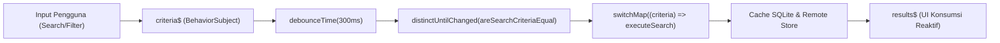

# Civic Pulse — Kontrak Integrasi Pertemuan 11
## Milestone 3: Real-Time Data Pipeline & Background Task Processing

Dokumen ini mendefinisikan kontrak tipe, arsitektur, kepemilikan modul, dan protokol integrasi lintas anggota tim (**Naufal**, **Syahril**, **Robi**) untuk **Pertemuan 11 (Sub-CPMK 9)**.

---

## 1. Pembagian Tanggung Jawab Modul

| Anggota Tim | Tanggung Jawab Utama | Berkas yang Dimiliki |
| :--- | :--- | :--- |
| **Naufal** *(Lead Architect & Security)* | Arsitektur stream, kontrak domain, interface provider realtime, integrasi backend, dan audit keamanan RLS. | `src/types/`, `src/providers/realtime/`, `src/services/reports/reportRepository.ts`, `supabase/migrations/` |
| **Syahril** *(Lead Frontend & UX)* | UI Search & Filter reaktif, integrasi RxJS pipeline, komponen list, banner status koneksi, dan penanganan flicker rendering. | `src/components/reports/`, `src/app/reports.tsx`, visual feedback state |
| **Robi** *(Lead Hardware & Storage)* | Layanan NetInfo native, cache terstruktur SQLite, antrean outbox offline, dan deteksi reconnect. | `src/services/network/`, `src/services/database/` (`sqliteDatabase.ts`, `reportCacheRepository.ts`, `outboxRepository.ts`) |

---

## 2. Kontrak Tipe dan Domain Final

### A. Model Laporan (`src/types/report.ts`)
```typescript
export type CivicReportCategory = "road-damage" | "flood" | "landslide" | "street-light";
export type ReportStatus = "submitted" | "verified" | "in_progress" | "resolved" | "rejected";

export type Report = {
  id: string;
  reporterId?: string | null;
  title: string;
  category: CivicReportCategory;
  description: string;
  status: ReportStatus;
  coordinate: {
    latitude: number;
    longitude: number;
  };
  mediaPath?: string | null;
  createdAt: string;
  updatedAt: string;
  deletedAt?: string | null;
  severity: "low" | "medium" | "high";
  isSimulation: boolean;
};
```

### B. Kriteria Pencarian & Komparator RxJS (`src/types/search.ts`)
```typescript
export type SearchCriteria = {
  query: string;
  category?: CivicReportCategory | "all";
  status?: ReportStatus | "all";
};

// Komparator untuk distinctUntilChanged pada stream kriteria
export function areSearchCriteriaEqual(a: SearchCriteria, b: SearchCriteria): boolean;
```

### C. Kontrak Event Realtime (`src/types/realtime.ts`)
```typescript
export type RealtimeEventType = "INSERT" | "UPDATE" | "DELETE";

export type RealtimeReportEvent = {
  type: RealtimeEventType;
  reportId: string;
  report: Report;
  timestamp: string;
  source: "supabase" | "mock_simulation";
};

export interface IRealtimeProvider {
  connect(): Promise<void>;
  disconnect(): Promise<void>;
  subscribe(onEvent: (event: RealtimeReportEvent) => void): () => void;
  isConnected(): boolean;
  getProviderName(): string;
}
```

### D. Kontrak Outbox & Status Sinkronisasi (`src/types/sync.ts`)
```typescript
export type NetworkStatusType = "online" | "offline" | "reconnecting";
export type SyncState = "idle" | "pending" | "syncing" | "synced" | "failed";

export type OutboxOperation<T = any> = {
  operationId: string;
  idempotencyKey: string;
  type: "CREATE_REPORT" | "UPDATE_STATUS";
  payload: T;
  status: "pending" | "processing" | "synced" | "failed_permanent";
  retryCount: number;
  error?: string | null;
  createdAt: string;
  updatedAt: string;
};
```

---

## 3. Alur Data Reaktif & RxJS Pipeline



### Ketentuan Pipeline:
1. **Debounce Time:** 300 ms untuk mengeliminasi pemanggilan berulang saat pengguna mengetik cepat.
2. **Distinct Until Changed:** Menggunakan komparator kriteria mendalam (memeriksa query yang dinormalisasi, kategori, dan status), bukan sekadar perbandingan referensi objek.
3. **SwitchMap:** Secara otomatis membatalkan (*cancel/ignore*) respon dari kueri pencarian sebelumnya bila ada kueri baru yang masuk, mengeliminasi race-condition.
4. **Resilience (catchError):** Error ditangani pada inner observable sehingga stream pencarian utama **tidak pernah mati**.

---

## 4. Siklus Hidup Event & Pembersihan Sumber Daya (*Cleanup*)

1. **Inisialisasi Screen (`useEffect`):**
   - Layar memanggil `reportRealtimeService.start()`.
   - Mengambil data awal dari cache SQLite lokal.
   - Melanggan ke `reportSearchService.searchResults$`.
2. **Pembersihan Unmount:**
   - Seluruh `Subscription` RxJS wajib di-`.unsubscribe()`.
   - Saluran realtime ditutup melalui `reportRealtimeService.stop()`.
   - Tidak ada channel/listener websocket yang tertinggal saat pengguna berpindah layar.
3. **Idempotensi & Ordering:**
   - Event `INSERT`: di-upsert ke SQLite berdasarkan primary key `id`.
   - Event `UPDATE`: hanya diterapkan jika `event.report.updatedAt >= existing.updatedAt`. Event kadaluarsa diabaikan.
   - Event `DELETE`: ditandai sebagai soft delete (`deleted_at = now()`).

---

## 5. Keputusan Backend dan Keamanan (Row Level Security)

1. **Status Backend Saat Ini:**
   - Repository belum memiliki instance Supabase live yang terhubung secara resmi melalui environment variable.
   - **Keputusan:** Menggunakan `MockRealtimeProvider` berlabel jelas `[Simulasi Realtime / Development Provider]` yang memancarkan event stream sungguhan berbasis RxJS.
   - Tersedia `SupabaseRealtimeProvider` yang siap beralih secara transparan saat `EXPO_PUBLIC_SUPABASE_URL` dan `EXPO_PUBLIC_SUPABASE_ANON_KEY` disuplai.
2. **Keamanan Kredensial:**
   - Hanya publishable/anon key yang diizinkan di sisi client mobile.
   - `service_role` key dilarang keras masuk ke dalam bundle mobile.
   - Berkas migrasi resmi PostgreSQL & RLS disediakan di:  
     `supabase/migrations/20261116000000_create_reports_table.sql`
   - Otorisasi pembaruan status laporan dibatasi hanya untuk role `official` dan `admin` melalui JWT claims server.
